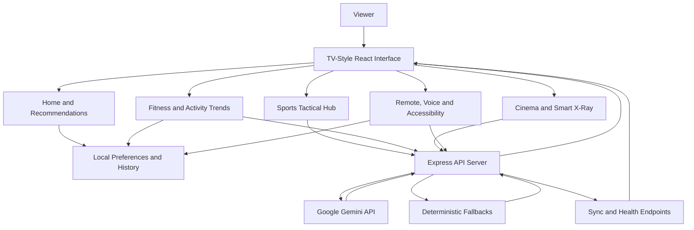

<div align="center">

# 📺 Vega TV
### The Intelligent Living Room Experience

**Watch Smarter. Move Better. Live Better.**

A smart-TV-inspired web experience that brings entertainment, AI-assisted sports insights, fitness coaching, personalized recommendations, accessibility, and wellness analytics into one living-room interface.

<br/>


<!-- Replace this placeholder with a screenshot or demo GIF from your project. -->
<!--  -->

</div>

---

## 📖 Table of Contents

- [Overview](#-overview)
- [The Problem](#-the-problem)
- [Our Solution](#-our-solution)
- [Key Features](#-key-features)
- [How It Works](#-how-it-works)
- [Technology Stack](#-technology-stack)
- [Architecture](#-architecture)
- [Project Structure](#-project-structure)
- [Getting Started](#-getting-started)
- [Environment Configuration](#-environment-configuration)
- [Available Scripts](#-available-scripts)
- [AI Integration](#-ai-integration)
- [Recommendation Engine](#-recommendation-engine)
- [Accessibility and TV Navigation](#-accessibility-and-tv-navigation)
- [Offline Storage and Synchronization](#-offline-storage-and-synchronization)
- [Privacy and Security Notes](#-privacy-and-security-notes)
- [Demo Data and Implementation Boundaries](#-demo-data-and-implementation-boundaries)
- [Roadmap](#-roadmap)
- [Troubleshooting](#-troubleshooting)
- [Contributing](#-contributing)
- [Acknowledgements](#-acknowledgements)
- [License](#-license)

---

## 🌌 Overview

**Vega TV** explores a different idea for the smart television: a TV should be more than a place to stream content. It can also be an accessible interface for discovering media, exploring sports tactics, building healthier routines, and reviewing personal activity trends.

The project combines a **10-foot TV-style interface** with a collection of interactive experiences:

- A personalized home screen and media recommendations.
- A simulated football tactical-analysis hub with AI-assisted insights.
- A fitness dashboard with exercise feedback concepts and seven-day activity trends.
- A cinema hub with media information and Smart X-Ray-style scene insights.
- Daily motivation, voice-command interaction, and audio feedback.
- A virtual TV remote designed around directional-pad navigation.
- Accessibility settings, user profiles, local preferences, diagnostics, and cloud-sync hooks.

The interface takes inspiration from the usability conventions of living-room platforms such as Fire TV and the wider Vega OS ecosystem. **Vega TV is an independent project and is not an official Amazon product or an official Fire OS/Vega OS distribution.**

## 🎯 The Problem

Traditional television experiences are largely designed around passive viewing. Content is usually presented in fixed grids, and entertainment recommendations may not consider a viewer's activity habits or recovery needs. Meanwhile, wellness tools often live in separate apps and devices rather than in the living room where people already spend time.

This creates several opportunities:

- **Fragmented experiences:** entertainment, fitness, and activity information are separated.
- **One-size-fits-all discovery:** recommendations may not adapt to a viewer's interests and routine.
- **Remote-first usability challenges:** a TV interface must work with directional controls and be readable from across a room.
- **Limited wellness context:** viewers may benefit from simple movement reminders and understandable activity summaries.
- **Connectivity interruptions:** core preferences and selected information should remain useful when a network connection is unavailable.

## 💡 Our Solution

Vega TV brings these experiences into one consistent, remote-friendly interface. Its recommendation engine combines viewing preferences with fitness-context signals, while the fitness and analytics views demonstrate how activity information could be presented in a living room. Gemini-powered server endpoints can generate sports analysis, daily motivation, Smart X-Ray-style insights, and voice-intent interpretation when the API is configured and available.

The application also includes deterministic fallback behavior and local persistence for selected settings and activity data, helping the interface remain usable when an AI request or network connection fails.

> **Project status:** This repository is a web-based prototype and demonstration. It is not, by itself, a certified television operating system, a production streaming service, a medical device, or proof of live professional sports tracking. See [Demo Data and Implementation Boundaries](#-demo-data-and-implementation-boundaries).

---

## ✨ Key Features

### 🏠 1. Personalized Home Screen

The home view brings featured media, category rails, watchlist items, fitness context, and personalized recommendations into a single dashboard.

- Horizontal content carousels designed for TV viewing.
- Featured content and category-based discovery.
- Watchlist and viewing-history signals.
- Recommendation presets:
  - **Balanced** — balances viewing affinity and fitness context.
  - **Fitness Synergy** — gives more weight to fitness-related context.
  - **Watch History** — prioritizes prior viewing patterns.
- A “Why was this recommended?” inspector that explains recommendation factors.
- Audio announcements for selected interface actions.

### ⚽ 2. AI-Assisted Sports Tactical Hub

The Sports view presents a football analysis experience with a tactical overlay and player-focused information.

- Simulated player markers and movement on a pitch.
- Player selection and contextual statistics.
- Tactical HUD controls and camera-view choices.
- Possession and expected-goals-trend fields.
- Server endpoint for Gemini-assisted tactical analysis.
- Fallback insights when AI generation is unavailable.

The sports interface is designed to demonstrate how computer-vision output and language-model explanations could work together. Player positions and movement values in the current prototype should be treated as **simulated demonstration data**, not as verified tracking from a live broadcast.

### 🎬 3. Cinema Hub and Smart X-Ray-Style Insights

The cinema experience presents media details and contextual information in a television-friendly layout.

- Cinema and documentary discovery.
- Media details such as synopsis, duration, rating, tags, and resolution labels.
- Smart X-Ray-style information for scene context, characters, production trivia, and related insights.
- A server endpoint for AI-generated X-Ray information.
- Playback-oriented interface concepts and accessible control patterns.

Actual licensed 4K streaming, HDR playback, Dolby Atmos output, and third-party streaming-provider integration are not supplied simply by this UI prototype.

### 🏋️ 4. Fitness Coach and Activity Trends

The Fitness view explores a camera-assisted, living-room fitness experience.

- Exercise modes including squats, jumping jacks, and lunges.
- Repetition and target tracking in the interface.
- Joint-angle and form-feedback presentation.
- Seven-day workout-intensity visualization.
- Activity duration, calories, intensity zones, and camera-confidence fields.
- Scheduled fitness-analysis reminders with a 30-minute lead-time setting.
- Audio chimes and speech-synthesis feedback.

The repository contains fitness UI and activity-history structures. Do not assume that all displayed pose estimates, calories, or intensity values come from a validated computer-vision or physiological measurement pipeline. Camera-based tracking depends on browser support, permissions, and an implemented pose-estimation pipeline.

### 📊 5. Global Fitness Leaderboard

The leaderboard presents a gamified view of activity consistency.

- Horizontal bar-chart visualization.
- Ranking, consistency score, active days, weekly minutes, and streak information.
- Filter options for leaderboard divisions.
- Refresh and spoken-announcement interactions.
- Medal-style visual treatment for top-ranked entries.

The included leaderboard records are demonstration data. They do not establish the existence of a live global network of Vega TV households.

### 🧠 6. Daily Motivation and Micro-Drills

Vega TV can present context-aware daily encouragement and short movement suggestions.

- Daily motivation cards.
- Actionable movement suggestions with estimated duration and intensity.
- AI-generated tips through the Gemini integration when available.
- Deterministic fallback content when the AI endpoint is unavailable.
- Text-to-speech narration and audio feedback.
- Habit-oriented interaction patterns.

Fitness content is for general wellness demonstration only and should not be treated as personalized medical advice.

### 🎮 7. Virtual TV Remote and Voice Interaction

The virtual remote demonstrates how a TV-first interface can be operated without a mouse.

- Directional-pad navigation.
- Select, Back, Home, Menu, Play/Pause, volume, and voice controls.
- Keyboard-driven navigation and focus handling.
- Visual button feedback and navigation chimes.
- Voice assistant modal and voice-intent endpoint.
- Text-to-speech announcements for supported actions.

Voice recognition and intent execution can vary by browser, operating system, microphone permissions, and configured AI availability.

### ♿ 8. Accessibility and Personalization

The settings experience includes options intended to improve readability and interaction.

- High-contrast mode.
- Normal, large, and extra-large typography settings.
- Audio feedback and volume controls.
- Screen-reader-style text-to-speech announcements.
- Color-vision filter options for protanopia, deuteranopia, and tritanopia.
- Multiple user-profile roles.
- Profile-lock/PIN interaction concepts.
- Accessibility and system diagnostic information.

These features are implementation-level options, not a claim of formal WCAG conformance or biometric authentication.

### 🔔 9. Scheduled Reminders and Audio Chimes

The project includes a configurable reminder model for a scheduled fitness analysis.

- Scheduled analysis time.
- Configurable alert lead time, with a 30-minute default.
- Active/inactive and repeat-daily settings.
- Distinctive synthesized audio feedback.
- Browser speech-synthesis announcements when supported.

Browser execution rules, tab suspension, autoplay policies, and notification permissions can affect whether reminders fire exactly as expected. Validate scheduling behavior in the target runtime before relying on it.

### 💾 10. Local Persistence, Diagnostics, and Sync Hooks

The project stores selected application data locally and exposes a backend synchronization path.

- Persistence for settings, profiles, active profile, watchlist, viewing history, activity history, and notification preferences.
- Local diagnostic log records.
- Online/offline state awareness.
- A sync queue/storage structure.
- A backend health endpoint.
- A server-side sync endpoint and profile-specific retrieval route.
- Graceful fallback paths for failed network or AI requests.

Local browser storage is not equivalent to a secure database, and the presence of a sync endpoint does not by itself provide production-grade multi-device synchronization.

---

## 🔄 How It Works

At a high level, Vega TV follows this flow:



**Typical interaction flow:**

1. The viewer opens the home screen and navigates using the on-screen remote or supported keyboard controls.
2. The app loads stored preferences, profile settings, watchlist items, and activity-history data.
3. The recommendation engine scores available media using viewing and fitness-context signals.
4. When an AI-backed feature is requested, the frontend calls the Express server rather than exposing the Gemini key in browser code.
5. The server calls Gemini when configured and returns structured results, or uses fallback behavior where implemented.
6. User settings and supported history are persisted locally. The application can attempt server synchronization when connectivity is available.

---

## 🧰 Technology Stack

| Technology | Role in Vega TV |
|---|---|
| **React 19** | Component-based user interface |
| **TypeScript** | Typed application models and frontend/backend code |
| **Vite** | Development tooling and production frontend build |
| **Tailwind CSS 4** | Styling utilities and responsive visual system |
| **Express 4** | Backend API routes and server middleware |
| **Google GenAI SDK** (`@google/genai`) | Server-side Gemini integration |
| **Recharts 3** | Activity trends and leaderboard charts |
| **Lucide React** | Interface icons |
| **Motion** | UI animation |
| **Web Audio API** | Synthesized navigation sounds and notification chimes |
| **Web Speech API** | Browser text-to-speech where supported |
| **Browser storage APIs** | Local persistence and selected encrypted-storage utilities |
| **Bun lockfile** | Dependency lockfile included with the repository |

### Architecture at a glance

- **Frontend:** React components, view modules, shared types, local storage helpers, and audio feedback utilities.
- **Backend:** Express server with health, AI, and synchronization endpoints.
- **AI layer:** Gemini requests are initiated on the server using `GEMINI_API_KEY`.
- **Fallback layer:** Deterministic responses are used by supported features when AI calls fail or time out.
- **Persistence layer:** Browser-side storage keeps selected user and application state between visits.

---

## 🗂️ Project Structure

```text
Hackathon-Project-Amazon-Developer-Hackathon-main/
├── src/
│   ├── components/
│   │   ├── views/
│   │   │   ├── HomeView.tsx
│   │   │   ├── SportsView.tsx
│   │   │   ├── CinemaView.tsx
│   │   │   ├── FitnessView.tsx
│   │   │   ├── GlobalFitnessLeaderboard.tsx
│   │   │   └── SettingsView.tsx
│   │   ├── DailyMotivationCard.tsx
│   │   ├── TopNav.tsx
│   │   ├── VirtualRemote.tsx
│   │   └── VoiceAssistantModal.tsx
│   ├── types/
│   │   └── tv.ts
│   ├── utils/
│   │   ├── audioFeedback.ts
│   │   └── offlineStorage.ts
│   ├── App.tsx
│   ├── index.css
│   └── main.tsx
├── server.ts
├── index.html
├── metadata.json
├── package.json
├── bun.lock
├── tsconfig.json
├── vite.config.ts
├── .env.example
└── .gitignore
```

### Important files

- `src/App.tsx` — top-level application state, navigation, profile selection, remote actions, and synchronization triggers.
- `src/components/views/HomeView.tsx` — home screen and recommendation scoring logic.
- `src/components/views/SportsView.tsx` — tactical sports interface and AI analysis request.
- `src/components/views/CinemaView.tsx` — cinema experience and Smart X-Ray-style content.
- `src/components/views/FitnessView.tsx` — workout interaction, intensity trends, and reminders.
- `src/components/views/GlobalFitnessLeaderboard.tsx` — leaderboard chart and ranking presentation.
- `src/components/views/SettingsView.tsx` — accessibility, profile, diagnostics, and sync settings.
- `src/components/VirtualRemote.tsx` — remote-control simulation.
- `src/components/VoiceAssistantModal.tsx` — voice assistant interface.
- `src/utils/offlineStorage.ts` — local persistence, sample data, diagnostic logging, and cloud-sync helper.
- `src/utils/audioFeedback.ts` — synthesized audio cues and speech-synthesis utilities.
- `src/types/tv.ts` — shared TypeScript types and application data models.
- `server.ts` — Express server and backend API routes.

---

## 🚀 Getting Started

### Prerequisites

Install the following before running the project:

- **Node.js:** Use a version compatible with the Vite version in `package.json`; Node.js 20.19+ or 22.12+ is a reasonable starting point for Vite 8.
- **npm** or **Bun** for dependency installation.
- A modern browser such as Chrome, Edge, or Firefox.
- A Gemini API key if you want to test Gemini-backed endpoints.

> The supplied package scripts use `tsx server.ts` to run the Express server and Vite middleware. Start the application with the development script rather than assuming that `vite --host` alone starts the full backend.

### 1. Download or clone the repository

If you have pushed the project to GitHub:

```bash
git clone <YOUR_REPOSITORY_URL>
cd <YOUR_REPOSITORY_FOLDER>
```

Alternatively, extract the project ZIP and open a terminal in the extracted project directory.

### 2. Install dependencies

Using npm:

```bash
npm install
```

Or using Bun:

```bash
bun install
```

The repository includes `bun.lock`, so Bun is also a suitable option.

### 3. Configure environment variables

Create a `.env` file in the project root:

```bash
cp .env.example .env
```

On Windows PowerShell, you can copy the example file with:

```powershell
Copy-Item .env.example .env
```

Open `.env` and replace the example values with your own configuration.

### 4. Start the application

```bash
npm run dev
```

Or, if you use Bun:

```bash
bun run dev
```

The server will print its local address when it starts. Open that address in your browser.

### 5. Verify the backend

When the server is running, open the health endpoint:

```text
http://localhost:3000/api/health
```

Use the actual host and port printed by your server if they differ. The health response reports server status and whether the Gemini client is configured.

### 6. Build for production

Build the frontend bundle:

```bash
npm run build
```

Then use the repository's deployment environment to run the server and serve the generated `dist` output. The included `start` script runs `tsx server.ts`; configure production dependencies, environment variables, and hosting appropriately before deploying.

---

## 🔐 Environment Configuration

The repository provides an `.env.example` file with these variables:

| Variable | Purpose | Required? |
|---|---|---|
| `GEMINI_API_KEY` | Server-side credential used by the Google GenAI SDK | Required for live Gemini API calls; fallback behavior may still work without it |
| `APP_URL` | Base URL for the hosted application, used by app-level URL logic | Depends on deployment and the routes that need it |

Example:

```dotenv
GEMINI_API_KEY="YOUR_GEMINI_API_KEY"
APP_URL="http://localhost:3000"
```

**Security rules:**

- Never commit a real `.env` file or API key to GitHub.
- Keep the Gemini API key on the server. Do not rename it to a `VITE_` variable, because Vite-exposed variables may be included in the client bundle.
- Rotate the key immediately if it is accidentally exposed.
- Apply usage limits and monitor API consumption in your provider account.
- Do not use a production secret in screenshots, recordings, public issue reports, or sample configuration.

The `.env.example` comments mention AI Studio runtime secret injection. That behavior applies only when running in a compatible environment; local development still needs its own environment configuration.

---

## 📜 Available Scripts

The scripts defined in `package.json` are:

| Command | Purpose |
|---|---|
| `npm run dev` | Runs `server.ts` through `tsx`, providing the app server and development middleware |
| `npm start` | Starts the server through `tsx server.ts` |
| `npm run build` | Builds the frontend with Vite |
| `npm run preview` | Starts Vite's preview server for the built frontend |
| `npm run lint` | Runs `tsc --noEmit` for TypeScript checking |
| `npm run clean` | Removes the `dist` directory and `server.js` on compatible shells |

Note: `npm run lint` is a TypeScript check, not a separate ESLint rule set. The `clean` script uses Unix-style `rm -rf`; on Windows, use an equivalent command or a compatible shell if needed.

---

## 🤖 AI Integration

Vega TV integrates the Google GenAI SDK in `server.ts`. The server reads `GEMINI_API_KEY` from the environment and uses AI-backed routes for features that benefit from natural-language analysis.

### Implemented API routes

| Method | Endpoint | Purpose |
|---|---|---|
| `GET` | `/api/health` | Reports server health and Gemini configuration status |
| `POST` | `/api/ai/sports-analysis` | Generates or returns fallback football tactical insights |
| `POST` | `/api/ai/xray` | Generates or returns fallback Smart X-Ray-style scene information |
| `GET` | `/api/ai/daily-motivation` | Returns daily motivation content |
| `POST` | `/api/ai/daily-motivation` | Generates context-aware daily motivation |
| `POST` | `/api/ai/voice-intent` | Parses a voice-related command into an application intent |
| `POST` | `/api/sync` | Accepts supported application data for synchronization |
| `GET` | `/api/sync/:profileId` | Retrieves profile-specific synchronization data |

### Reliability strategy

- AI requests are wrapped in timeout handling.
- Prompts and expected output structures are designed for specific tasks.
- Supported routes can return deterministic fallback content when a request fails.
- API credentials remain in the server environment rather than being embedded in React components.

The model identifier configured in the supplied source is `gemini-3.8-flash`. Model availability and naming can change; confirm the currently supported identifier in your Google AI documentation and update the server configuration if necessary.

### Example health-check response

The precise response depends on the server implementation, but the health endpoint is intended to provide a status similar to:

```json
{
  "status": "ok",
  "geminiEnabled": true
}
```

Use the actual response from your running application as the source of truth.

---

## 🧮 Recommendation Engine

The home screen calculates media affinity using a weighted scoring approach. It combines viewing-history signals, fitness context, and profile/category relevance.

A simplified conceptual model is:

\[
S(u,m)=w_hH(u,m)+w_fF(u,m)+w_pP(u,m)
\]

Subject to:

\[
w_h+w_f+w_p=1,\qquad w_h,w_f,w_p\geq0
\]

Where:

- \(S(u,m)\) — score for recommending media item \(m\) to user \(u\).
- \(H(u,m)\) — watch-history affinity, including category and tag overlap.
- \(F(u,m)\) — fitness-context or recovery compatibility.
- \(P(u,m)\) — profile and content relevance.
- \(w_h,w_f,w_p\) — weights selected by the recommendation preset.

### Presets

- **Balanced:** combines viewing affinity, fitness context, and profile relevance.
- **Fitness Synergy:** increases the influence of fitness-related context and recovery-oriented content.
- **Watch History:** prioritizes the viewer's known media preferences.

The home view also provides recommendation explanations and an inspector for reviewing factor contributions.

> This equation is an explanatory model of the scoring concept. Refer to `calculateRecommendations()` in `src/components/views/HomeView.tsx` for the actual implementation. The prototype's recommendation scores should not be interpreted as validated measures of user preference.

---

## ♿ Accessibility and TV Navigation

Vega TV is designed around the ergonomics of a **10-foot interface**: users may be sitting several feet away and interacting with a directional remote rather than a mouse.

The project includes:

- Large content cards and readable typography.
- Visible focus styling for selected items.
- Directional navigation handlers.
- A virtual remote with select, back, home, menu, volume, and voice interactions.
- High-contrast and font-scale preferences.
- Color-vision filter settings.
- Optional audio feedback and speech synthesis.

### Keyboard and remote testing

Test the interface with the arrow keys and the supported selection/back controls. Also test the virtual remote directly in the browser. Browser-specific keyboard mappings and media-key behavior may vary.

For production readiness, conduct manual keyboard testing, screen-reader testing, focus-order checks, contrast measurements, and WCAG accessibility evaluation. The existence of accessibility settings alone does not guarantee conformance.

---

## 💾 Offline Storage and Synchronization

The app uses browser-side persistence for selected state, including:

- User profiles and the active profile.
- Accessibility settings.
- Watchlist and viewing history.
- Fitness intensity history.
- Notification scheduling preferences.
- Diagnostic logs and synchronization-related state.

The storage helper is implemented in `src/utils/offlineStorage.ts`. Some data is written through `localStorage`, and the helper includes an encrypted-storage utility using the Web Crypto API.

### Online/offline behavior

The application listens for browser online/offline events and can attempt a sync when connectivity returns. The backend exposes `/api/sync` and `/api/sync/:profileId` routes for the app's synchronization flow.

**Important distinction:** The current implementation should not be described as complete offline streaming or guaranteed multi-device synchronization. Browser storage can be cleared, server persistence and conflict handling must be verified, and cached application data is different from licensed media downloads.

### Recommended next steps

For a production deployment, consider:

- IndexedDB for larger structured local datasets.
- A documented sync schema and versioning strategy.
- Authentication and server-side authorization for every profile.
- Conflict resolution and retry/backoff handling.
- Explicit retention and deletion controls.
- Tests for offline startup, reconnect behavior, duplicate requests, and interrupted syncs.

---

## 🔒 Privacy and Security Notes

Vega TV may involve profile information, watch history, activity data, voice input, and camera-related interactions. These deserve careful treatment.

- Keep API keys server-side.
- Request camera and microphone permission only when the user invokes a feature that needs them.
- Clearly communicate when a camera or microphone is active.
- Avoid transmitting raw camera or microphone data unless required and explicitly disclosed.
- Minimize stored personal information and provide a way to clear local data.
- Protect profile and sync routes with authentication and authorization before using real user accounts.
- Validate and constrain incoming request bodies on the server.
- Apply rate limits, secure headers, CORS policy, and appropriate deployment logging.
- Review encryption key management carefully. Client-side encryption is only as strong as its key handling and threat model.
- Do not claim end-to-end encryption, biometric security, or production-grade data protection without verifying the implementation.

The profile PIN/lock UI is not equivalent to operating-system biometric authentication. Likewise, local browser storage does not provide the same protections as a hardened server-side data store.

---

## 🧪 Demo Data and Implementation Boundaries

This repository includes seeded media, workout history, player positions, leaderboard entries, and other values to make the interface demonstrable.

Keep these distinctions in mind when presenting the project:

| Capability | What the prototype demonstrates | What requires further implementation or verification |
|---|---|---|
| Sports tracking | Tactical overlays, player markers, statistics, AI insight UI | Reliable tracking of a real broadcast, validated coordinates, and real-time performance |
| Fitness pose engine | Exercise UI, pose-feedback concepts, rep counters, trends | A robust camera pipeline, pose-estimation model, calibration, and validation |
| Health analytics | Activity-intensity charts and sample metrics | Validated physiological measurements or wearable integrations |
| Cinema | Media discovery and Smart X-Ray-style interface | Licensed streaming sources, DRM, actual 4K/HDR playback, and spatial-audio output |
| Gemini AI | Server-side AI routes and fallback behavior | A valid key, supported model identifier, quota, connectivity, and runtime testing |
| Voice | Voice modal, intent endpoint, speech synthesis | Consistent microphone access and speech-recognition support across target devices |
| Offline support | Local persistence and network-state handling | Guaranteed offline media playback and robust multi-device sync |
| Security | Profile-lock concepts and an encrypted-storage helper | Production authentication, authorization, key management, and security review |
| Leaderboard | Chart and seeded ranking data | A real authenticated user network and trustworthy ranking backend |

This distinction helps ensure that demonstrations are transparent and technically credible.

---

## 🗺️ Roadmap

### Phase 1 — Core experience
- [x] TV-style home screen and navigation.
- [x] Content categories and recommendation presets.
- [x] Virtual remote interaction.
- [x] Accessibility settings and audio feedback.
- [x] Fitness, sports, cinema, and leaderboard views.

### Phase 2 — AI-assisted interactions
- [x] Server-side Gemini integration points.
- [x] Sports-analysis and daily-motivation routes.
- [x] Smart X-Ray-style AI endpoint.
- [x] Voice-intent endpoint.
- [x] Fallback behavior for supported AI features.

### Phase 3 — Reliability and data
- [x] Local persistence for selected application state.
- [x] Online/offline event handling.
- [x] Health and sync endpoints.
- [x] Diagnostic logging and activity charts.

### Future development
- [ ] Integrate and validate a real-time pose-estimation model.
- [ ] Connect supported health platforms and wearable devices with user consent.
- [ ] Add authenticated, persistent cloud profiles and robust conflict resolution.
- [ ] Integrate authorized media sources and playback infrastructure.
- [ ] Add real sports-video tracking and benchmark latency/accuracy.
- [ ] Improve automated testing and continuous integration.
- [ ] Validate accessibility against WCAG criteria and test on actual TV hardware.
- [ ] Explore device-specific packaging and compatibility for Fire TV/Vega OS environments.

The checkboxes describe the repository's current prototype-level features, not production certification or a claim that all future integrations are complete.

---

## 🛠️ Troubleshooting

### The app does not start

1. Confirm that Node.js and npm or Bun are installed.
2. Install dependencies again with `npm install` or `bun install`.
3. Run `npm run dev` from the directory containing `package.json`.
4. Read the terminal output for port conflicts, dependency errors, or TypeScript problems.

### Gemini-powered features return fallback content

- Confirm that `.env` exists in the project root.
- Verify that `GEMINI_API_KEY` contains a valid key.
- Restart the server after changing environment variables.
- Check the terminal logs and `/api/health`.
- Confirm that the configured model identifier is available to your API key and account.
- Check network access, quota, and API errors.

Fallback content is expected when an AI request cannot complete in features that implement fallback handling.

### Camera or microphone access is unavailable

- Use a supported browser and grant permission when prompted.
- Check the browser's site permissions.
- Camera and microphone access generally requires HTTPS or a trusted local development origin.
- Confirm that the target feature has a working media-capture or inference pipeline; permission alone does not implement pose estimation or speech recognition.

### Audio feedback does not play

- Interact with the page first; browsers may block audio before a user gesture.
- Check system volume and the app's volume setting.
- Confirm that speech synthesis is available in the browser.
- Try a current desktop browser if testing on a restricted embedded environment.

### Sync does not work

- Confirm that the Express server is running.
- Inspect the browser's Network panel and the server logs.
- Check the `/api/sync` response and required request fields.
- Remember that a successful demo request does not guarantee durable cloud persistence or multi-device conflict resolution.

### TypeScript checking fails

```bash
npm run lint
```

Review the reported TypeScript errors and ensure the installed dependency versions match the lockfile. This command performs TypeScript checking; it does not run a separate ESLint configuration.

---

## 🤝 Contributing

Contributions, ideas, bug reports, and usability feedback are welcome.

1. Fork the repository.
2. Create a feature branch:

   ```bash
   git checkout -b feature/your-feature
   ```

3. Make focused changes and keep the TV-first interaction model in mind.
4. Run the available checks:

   ```bash
   npm run lint
   npm run build
   ```

5. Test the relevant feature manually, including keyboard navigation and fallback behavior where applicable.
6. Commit your changes and open a pull request describing the motivation, implementation, and testing performed.

### Contribution guidelines

- Keep components focused and reusable.
- Use TypeScript types for shared data structures.
- Keep secrets out of source control.
- Do not present simulated data as verified live measurements.
- Preserve readable, remote-friendly layouts and visible focus states.
- Document new environment variables and API routes.
- Include screenshots or a short demo recording when they clarify a UI change.

---

## 🙌 Acknowledgements

Vega TV brings together ideas and tools from the following ecosystems:

- **React** and **Vite** for modern frontend development.
- **TypeScript** for typed application development.
- **Tailwind CSS** for interface styling.
- **Google Gemini** and the Google GenAI SDK for AI-assisted features.
- **Recharts** for data visualization.
- **Lucide React** for icons.
- **Web Audio API** and **Web Speech API** for browser-based audio feedback.
- The design conventions of modern living-room and 10-foot user interfaces.

All trademarks and product names belong to their respective owners. References to Amazon, Fire TV, Vega OS, Google, and Gemini are descriptive and do not imply endorsement or official affiliation.

---

## 📄 License

No license file was included in the supplied project archive. Before publishing or accepting external contributions, add a `LICENSE` file that reflects the terms you choose and that you have the right to apply. Until then, do not assume that the repository is open-source licensed.

---

<div align="center">

### 📺 Vega TV
**Watch Smarter. Move Better. Live Better.**

*An exploration of a more adaptive, accessible, and wellness-aware living room experience.*

</div>
